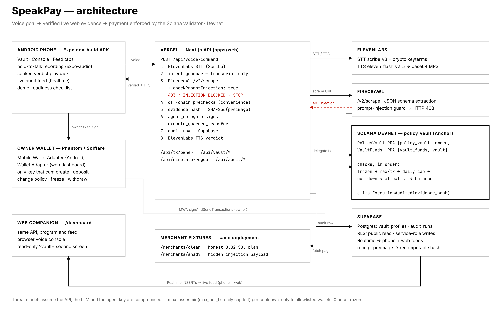

# SpeakPay — talk to pay, inside limits the AI can't break

SpeakPay is a voice-first Solana Mobile payment agent. You hold the mic and say what you want to pay
for. SpeakPay reads the live merchant page through **Firecrawl**, which blocks prompt-injection traps
before anything else sees the page. It then pays through a custom **Anchor** program whose spending
limits are enforced by the Solana validator, not by an AI prompt. Every payment carries a SHA-256
evidence hash linking the on-chain transfer to what was said and what the page showed. The full
receipt lives in **Supabase**, and **ElevenLabs** handles the voice in both directions.

> Built for the Dev3pack Global Solana Hackathon (27–29 Nov 2026) · Solana **Devnet** only, no real funds.

**Live app:** _pending deployment_ · **Android APK:** _pending release_ · **Demo video:** _pending_

## Judge & Sponsor Verification Map

<!-- verification-map:start -->
Pinned to commit [`572eb73`](https://github.com/jayo14/speakpay/tree/572eb73eab9f1fd615f1d6c3e922d219b24e0084). Regenerate with `pnpm readme:map`.

**Program (Devnet):** `2ZgTwPCnLhXTwTNW8AZKoxuh6zy1NKgCTr3ekbch8YfU` — [Explorer](https://explorer.solana.com/address/2ZgTwPCnLhXTwTNW8AZKoxuh6zy1NKgCTr3ekbch8YfU?cluster=devnet)

| Integration | What to check | Code (permalinks) | Live proof |
|---|---|---|---|
| **Solana — Anchor program** | 6 instructions on two PDAs; ordered policy checks; custom `PolicyError` | [`execute_guarded_transfer`](https://github.com/jayo14/speakpay/blob/572eb73eab9f1fd615f1d6c3e922d219b24e0084/programs/policy-vault/src/lib.rs#L112-L177)<br>[`check order (§4.3)`](https://github.com/jayo14/speakpay/blob/572eb73eab9f1fd615f1d6c3e922d219b24e0084/programs/policy-vault/src/policy.rs#L43-L103)<br>[`PolicyError 6000–6009`](https://github.com/jayo14/speakpay/blob/572eb73eab9f1fd615f1d6c3e922d219b24e0084/programs/policy-vault/src/errors.rs#L6-L27)<br>[`PolicyVault PDA`](https://github.com/jayo14/speakpay/blob/572eb73eab9f1fd615f1d6c3e922d219b24e0084/programs/policy-vault/src/state.rs#L10-L26) | _deploy: pending_<br>_PASSED payment: pending_<br>_rogue → ExceedsMaxPerTx: pending_<br>_frozen → VaultFrozen: pending_ |
| **Solana — tests** | check order, every error code, PDA seeds, byte-level codec vectors | [`policy tests`](https://github.com/jayo14/speakpay/blob/572eb73eab9f1fd615f1d6c3e922d219b24e0084/programs/policy-vault/src/policy.rs#L122)<br>[`codec vectors`](https://github.com/jayo14/speakpay/blob/572eb73eab9f1fd615f1d6c3e922d219b24e0084/programs/policy-vault/src/lib.rs#L335)<br>[`TS ↔ Rust bytes`](https://github.com/jayo14/speakpay/blob/572eb73eab9f1fd615f1d6c3e922d219b24e0084/packages/shared/test/codec.test.ts#L42) | CI: `pnpm test:program:host`, `pnpm test` |
| **Solana Mobile — MWA** | Native Expo dev-build APK; owner txs signed with MWA | [`MobileWalletProvider`](https://github.com/jayo14/speakpay/blob/572eb73eab9f1fd615f1d6c3e922d219b24e0084/apps/mobile/components/app-providers.tsx#L13)<br>[`signAndSendTransactions`](https://github.com/jayo14/speakpay/blob/572eb73eab9f1fd615f1d6c3e922d219b24e0084/apps/mobile/features/vault/use-vault.ts#L35) | _APK release: pending_ |
| **Firecrawl** | `POST /v2/scrape`, top-level `checkPromptInjection: true`, JSON schema, 403 halts the run | [`request body`](https://github.com/jayo14/speakpay/blob/572eb73eab9f1fd615f1d6c3e922d219b24e0084/apps/web/lib/firecrawl.ts#L30)<br>[`403 classification`](https://github.com/jayo14/speakpay/blob/572eb73eab9f1fd615f1d6c3e922d219b24e0084/apps/web/lib/firecrawl.ts#L65-L75)<br>[`halt before signing`](https://github.com/jayo14/speakpay/blob/572eb73eab9f1fd615f1d6c3e922d219b24e0084/apps/web/app/api/voice-command/route.ts#L146-L154)<br>[`injected fixture`](https://github.com/jayo14/speakpay/blob/572eb73eab9f1fd615f1d6c3e922d219b24e0084/apps/web/app/merchants/shady/page.tsx#L29) | `pnpm firecrawl:check` log → `docs/firecrawl-403.txt` |
| **ElevenLabs STT** | Scribe (`scribe_v3`) with crypto keyterms | [`transcribe()`](https://github.com/jayo14/speakpay/blob/572eb73eab9f1fd615f1d6c3e922d219b24e0084/apps/web/lib/elevenlabs.ts#L32-L57) | transcript on every audit row |
| **ElevenLabs TTS** | `eleven_flash_v2_5`, base64 MP3 in the API response | [`speak()`](https://github.com/jayo14/speakpay/blob/572eb73eab9f1fd615f1d6c3e922d219b24e0084/apps/web/lib/elevenlabs.ts#L63-L85) | _demo video: pending_ |
| **Supabase** | Schema + RLS; Realtime feed on phone and web | [`audit_runs`](https://github.com/jayo14/speakpay/blob/572eb73eab9f1fd615f1d6c3e922d219b24e0084/supabase/migrations/001_init.sql#L19)<br>[`Realtime`](https://github.com/jayo14/speakpay/blob/572eb73eab9f1fd615f1d6c3e922d219b24e0084/supabase/migrations/001_init.sql#L52)<br>[`mobile subscription`](https://github.com/jayo14/speakpay/blob/572eb73eab9f1fd615f1d6c3e922d219b24e0084/apps/mobile/features/feed/use-audit-feed.ts#L32)<br>[`web subscription`](https://github.com/jayo14/speakpay/blob/572eb73eab9f1fd615f1d6c3e922d219b24e0084/apps/web/app/dashboard/_components/audit-feed.tsx#L49)<br>[`server insert`](https://github.com/jayo14/speakpay/blob/572eb73eab9f1fd615f1d6c3e922d219b24e0084/apps/web/lib/audit.ts#L10-L17) | _live dashboard: pending_ |
| **Evidence hash** | SHA-256(transcript + scraped JSON + payment) → on-chain event → recomputable receipt | [`preimage`](https://github.com/jayo14/speakpay/blob/572eb73eab9f1fd615f1d6c3e922d219b24e0084/packages/shared/src/evidence.ts#L18-L36)<br>[`ExecutionAudited`](https://github.com/jayo14/speakpay/blob/572eb73eab9f1fd615f1d6c3e922d219b24e0084/programs/policy-vault/src/events.rs#L32-L40)<br>[`verify`](https://github.com/jayo14/speakpay/blob/572eb73eab9f1fd615f1d6c3e922d219b24e0084/apps/web/lib/verify.ts#L28-L37) | _verify link: pending_ |
| **Rogue-agent proof** | Delegate signs directly, preflight skipped so the validator records the rejection | [`simulate-rogue`](https://github.com/jayo14/speakpay/blob/572eb73eab9f1fd615f1d6c3e922d219b24e0084/apps/web/app/api/simulate-rogue/route.ts#L37) | _failed tx 0x1771: pending_ |
| **Voice kill switch** | Owner-signed `toggle_freeze`, verified on-chain before it is logged | [`toggle_freeze`](https://github.com/jayo14/speakpay/blob/572eb73eab9f1fd615f1d6c3e922d219b24e0084/programs/policy-vault/src/lib.rs#L180-L189)<br>[`audit/freeze`](https://github.com/jayo14/speakpay/blob/572eb73eab9f1fd615f1d6c3e922d219b24e0084/apps/web/app/api/audit/freeze/route.ts#L24-L94) | _freeze tx: pending_ |
<!-- verification-map:end -->

## How it works

```
Phone (Expo APK, MWA) ──hold to talk──► Next.js API on Vercel
  owner signs: create / deposit /         1. ElevenLabs STT (Scribe)
  freeze / withdraw (one tap each)        2. intent grammar (transcript only)
                                          3. Firecrawl /v2/scrape + checkPromptInjection
                                               └─ 403 → INJECTION_BLOCKED, stop
                                          4. evidence hash = SHA-256(preimage)
                                          5. agent delegate → execute_guarded_transfer ──► Solana Devnet
                                          6. Supabase audit row → Realtime → phone + web   policy_vault
                                          7. ElevenLabs TTS verdict                          (PDA vault)
```



Editable source: [`docs/architecture.excalidraw`](docs/architecture.excalidraw) (open at excalidraw.com) · regenerate all formats with `pnpm diagram` · spec: [`PRD.md`](./PRD.md).

## Security model

- **Two keys, two powers.** The owner's wallet (MWA / Wallet Adapter) is the only key that can create,
  fund, change policy, freeze or withdraw. The server's `agent_delegate` key can only call
  `execute_guarded_transfer`.
- **The chain is the guardrail.** Each payment must pass every check, in a fixed order:
  - the vault is not frozen
  - the amount is ≤ `max_per_tx`
  - the rolling daily cap is not exceeded
  - the cooldown has passed
  - the recipient is on the allowlist (if one is set)
  - the vault keeps its rent-exempt minimum

  Assume the backend, the LLM and the delegate key are all compromised: the most an attacker can take is
  `min(max_per_tx, cap remaining)` per cooldown, only to allowlisted wallets, and nothing once the owner
  freezes the vault. The **Simulate Rogue Agent** button proves this: it skips every off-chain check, and
  the validator rejects the payment on-chain.
- **Poisoned pages never reach the agent.** Firecrawl's `checkPromptInjection` stops the run before
  hashing or signing, and SpeakPay never sends page content to any LLM.
- **Known limitations:**
  - `/api/voice-command` trusts the `vault_pda` it's given, so anyone who knows a vault can trigger payments
    that fit its policy.
  - The delegate is a server-held hot key, bounded by the policy above.
  - Voice transcripts are stored publicly for this demo.

## Why the merchant pages are not mocks

`/merchants/clean` and `/merchants/shady` are real, public HTTPS pages served by our own deployment and
scraped live by Firecrawl on every run. We host them for two reasons: real vendors throw bot walls or
change mid-demo, and planting prompt injections on someone else's site would be unethical. Nothing in
SpeakPay is mocked. Every transaction settles on Devnet, every scrape and voice turn hits the live API,
and every receipt is a real Supabase row.

## Run it

Setup and every environment variable: [`ENVIRONMENT.md`](./ENVIRONMENT.md). Commands: [`AGENTS.md` §4](./AGENTS.md).

```bash
pnpm install
```

```bash
pnpm test:program:host && pnpm test
```

```bash
pnpm dev:web
```

```bash
pnpm android
```

Install the APK on a phone: enable *Install unknown apps*, open the `.apk` from the GitHub Release, and put
Phantom or Solflare into Devnet (Phantom: Settings → Developer Settings → Testnet Mode → Solana Devnet).

## Planning docs

| Doc | Contents |
|---|---|
| [`PRD.md`](./PRD.md) | Vision, demo script, architecture, Anchor spec, API contracts, schema, decisions |
| [`MILESTONES.md`](./MILESTONES.md) | 40-hour plan, handoffs, verification gates, submission checklist |
| [`AGENTS.md`](./AGENTS.md) / [`CLAUDE.md`](./CLAUDE.md) | Rules for AI coding agents (Zero-Mock policy, guardrails, done-checks) |
| [`ENVIRONMENT.md`](./ENVIRONMENT.md) | Every env var, public vs secret, and how to obtain it |

## Team

_Names and handles, plus a note for the Nigeria Local track: added at submission._
